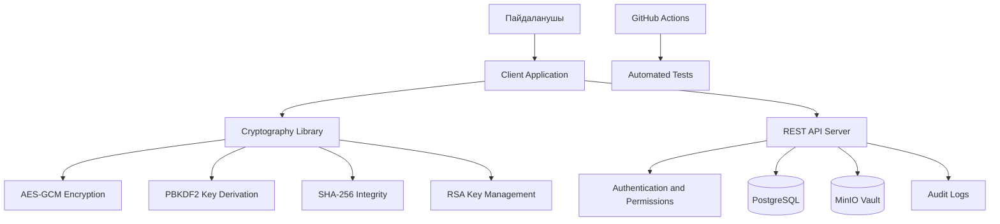
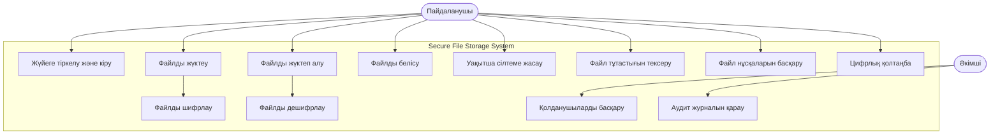
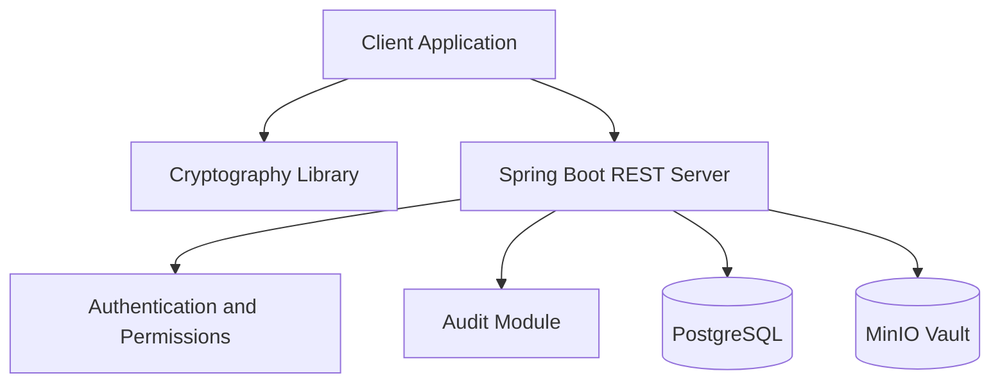
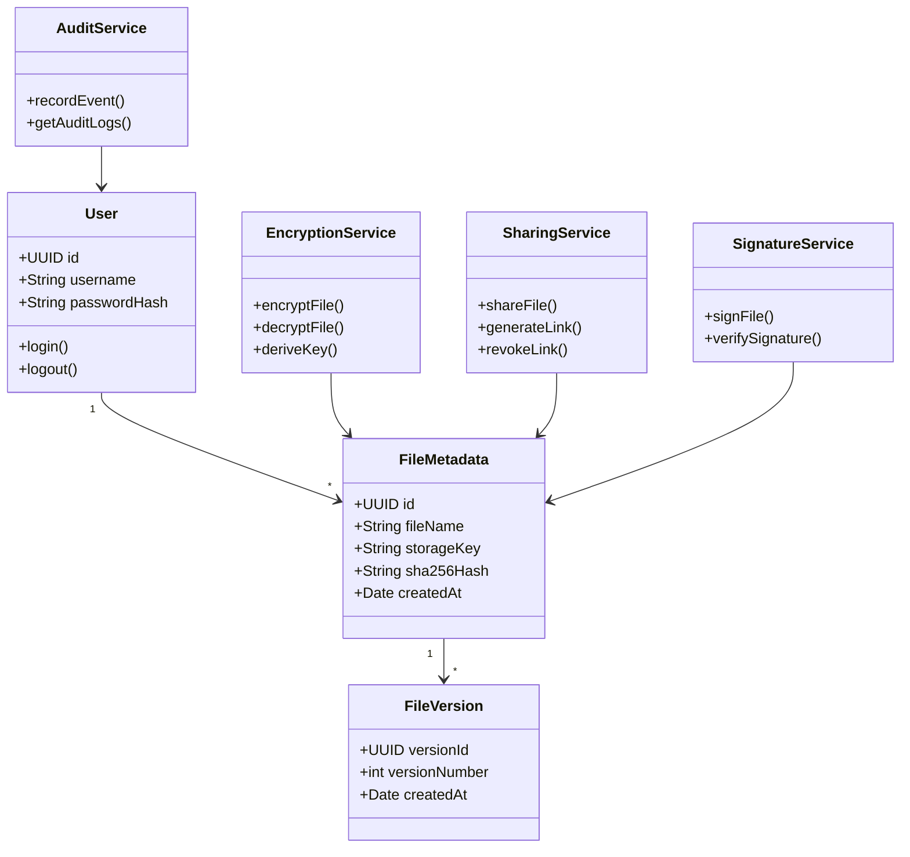
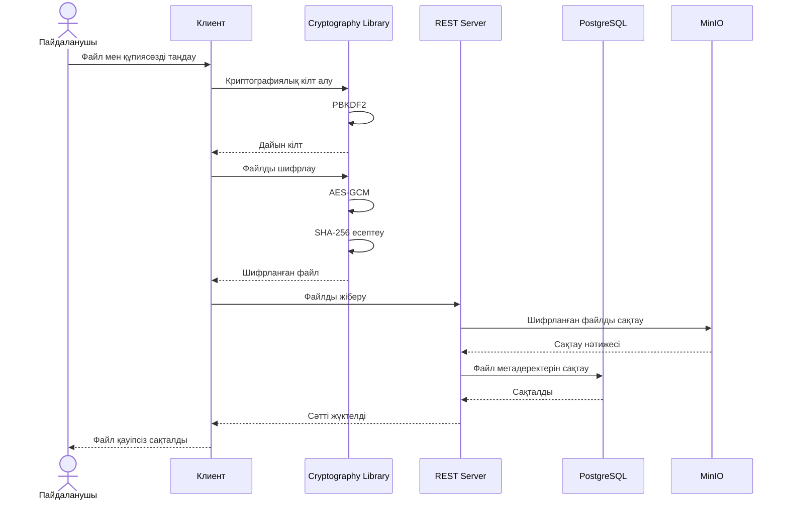

# 🔐 Қауіпсіз файлдарды сақтау және алмасу жүйесі
### Secure File Storage & Sharing System

## 📌 Жоба туралы

Бұл жоба — пайдаланушылардың файлдарын қауіпсіз сақтауға, жүктеуге, жүктеп алуға және басқа пайдаланушылармен бөлісуге арналған ақпараттық жүйе.

Жүйенің басты ерекшелігі — файлдар серверге жіберілмей тұрып, клиент жағында шифрланады. Осылайша, қоймада файлдардың тек шифрланған нұсқасы сақталады.

Жоба Java 17+, Spring Boot, PostgreSQL, MinIO және Java Cryptography Architecture (JCA) технологиялары негізінде әзірленеді.

## 🎯 Жобаның мақсаты

Пайдаланушылардың деректерін рұқсатсыз қол жеткізуден қорғау және файлдармен қауіпсіз алмасу мүмкіндігін қамтамасыз ету.

**Негізгі міндеттері:**
- Файлдарды AES-GCM алгоритмі арқылы шифрлау.
- Құпиясөз негізінде PBKDF2 арқылы криптографиялық кілт алу.
- SHA-256 арқылы файлдың тұтастығын тексеру.
- RSA көмегімен файлдарды қауіпсіз бөлісу.
- Мерзімі шектелген сілтемелер жасау.
- Файлдардың бірнеше нұсқасын сақтау.
- Электрондық цифрлық қолтаңбаны қолдану.
- Пайдаланушылардың құқықтары мен әрекеттерін бақылау.

## ⚙️ Қолданылатын технологиялар

| Технология | Қолданылу мақсаты |
|---|---|
| Java 17+ | Негізгі бағдарламалау тілі |
| Spring Boot | REST API серверін құру |
| JCA | Криптографиялық операциялар |
| AES-256-GCM | Файлдарды шифрлау |
| PBKDF2 | Құпиясөзден кілт алу |
| SHA-256 | Файл тұтастығын тексеру |
| RSA-OAEP | Шифрлау кілтін қауіпсіз бөлісу |
| RSA-PSS | Электрондық қолтаңба |
| PostgreSQL | Деректер базасы |
| MinIO | Шифрланған файлдарды сақтау |
| Maven | Тәуелділіктерді басқару |
| JUnit 5 | Автоматты тестілеу |
| GitHub Actions | CI/CD және тестілеуді автоматтандыру |

## 🏗️ Жүйенің архитектурасы

Жүйе бірнеше негізгі модульден тұрады:

1. **Client Application** — пайдаланушымен өзара әрекеттесетін консольдік немесе JavaFX қосымшасы.
2. **Cryptography Library** — шифрлау, дешифрлау, хэштеу және цифрлық қолтаңба операциялары.
3. **REST Server** — клиент пен сервер арасындағы сұраныстарды өңдеу.
4. **Database** — пайдаланушылар, файлдар және рұқсаттар туралы ақпаратты сақтау.
5. **MinIO Vault** — шифрланған файлдарды сақтау қоймасы.
6. **Security & Audit** — қолжетімділікті басқару және әрекеттерді тіркеу.
7. **Testing & CI** — тестілеу және автоматтандырылған тексеру.

### Архитектура диаграммасы



## 📊 UML диаграммалары

### 1. Use Case Diagram — жүйені пайдалану сценарийлері

Бұл диаграмма пайдаланушы мен әкімшінің жүйеде қандай әрекеттер орындай алатынын көрсетеді.



### 2. Component Diagram — жүйе компоненттері



### 3. Class Diagram — жүйе кластары



### 4. Sequence Diagram — файлды қауіпсіз жүктеу



## 🔒 Қауіпсіздік мүмкіндіктері

| Функция | Сипаттамасы |
|---|---|
| AES-GCM | Файлдарды шифрлау және аутентификациялау |
| PBKDF2 | Құпиясөз негізінде криптографиялық кілт алу |
| SHA-256 | Деректердің тұтастығын тексеру |
| RSA-OAEP | Кілттерді қауіпсіз бөлісу |
| RSA-PSS | Электрондық цифрлық қолтаңба |
| Expiring Links | Мерзімі шектелген сілтемелер |
| Access Control | Қолжетімділік құқықтарын басқару |
| Audit Logs | Жүйедегі әрекеттерді тіркеу |

**Қауіпсіздік талаптары:**
- Файлдар серверге жіберілмей тұрып шифрланады.
- MinIO қоймасында тек шифрланған файлдар сақталады.
- Құпиясөздер мен жеке кілттер GitHub-қа жүктелмейді.
- Әр файл үшін бірегей nonce қолданылады.
- Сервермен байланыс HTTPS арқылы қорғалады.

## 📁 Жоба құрылымы

```text
secure-file-storage/
│
├── client/
├── server/
├── crypto-library/
├── database/
├── docs/
│   └── diagrams/
├── tests/
├── .github/
│   └── workflows/
│       └── ci.yml
│
├── README.md
├── LICENSE
├── .gitignore
└── pom.xml
```

## 🧪 Тестілеу және CI/CD

Жоба аясында кемінде 20 JUnit 5 тест жазылады.

Тестілеу бағыттары:
- AES-GCM шифрлау және дешифрлау.
- PBKDF2 кілт алу.
- SHA-256 тұтастықты тексеру.
- RSA кілттерін генерациялау және бөлісу.
- Электрондық қолтаңбаны тексеру.
- Файл нұсқаларын басқару.
- Қол жеткізу құқықтарын тексеру.
- Мерзімі өткен сілтемелерді тексеру.
- Қате құпиясөздер мен бүлінген файлдарды өңдеу.

GitHub Actions арқылы әр Pull Request және Push кезінде автоматты тестілеу жүргізіледі.

## 🌿 Git жұмыс тәртібі

Команда Git Flow негізіндегі жұмыс тәртібін қолданады.

- `main` — жобаның тұрақты нұсқасы.
- `develop` — әзірлеу жұмыстары біріктірілетін тармақ.
- `feature/*` — жеке функцияларды әзірлеуге арналған тармақтар.

Барлық өзгерістер Pull Request арқылы енгізіледі. Код кемінде бір команда мүшесінің Code Review тексеруінен өтуі керек.

## 📅 Жобаның орындалу кезеңдері

| Sprint | Жұмыс мазмұны |
|---|---|
| Sprint 1 | Жоспарлау, архитектура, UML, GitHub және Trello баптау |
| Sprint 2 | Шифрлау, файл сақтау, бөлісу және деректер базасы |
| Sprint 3 | Қауіпсіздікті күшейту, тестілеу, CI/CD және қорғау |

## 👥 Команда құрамы

| Қатысушы | Рөлі |
|---|---|
| Әуелбек Бақытжан | Team Lead |
| Кейін анықталады | Backend Developer |
| Кейін анықталады | Cryptography Developer |
| Кейін анықталады | Database Developer |
| Кейін анықталады | QA / Testing |

## 📌 Жоба мәртебесі

**Ағымдағы кезең:** Жоспарлау және архитектура

**Жоба ұзақтығы:** 1 ай

**Команда:** Secure File Storage Team

## 📜 Лицензия

Бұл жоба MIT License лицензиясы негізінде әзірленеді.
