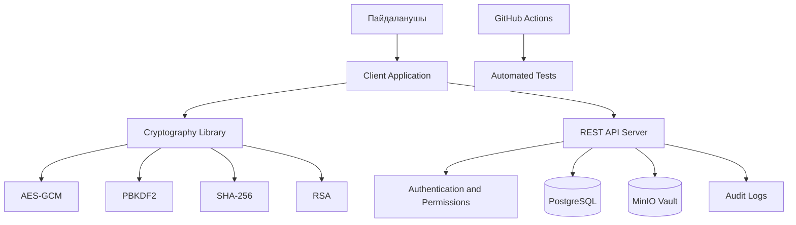
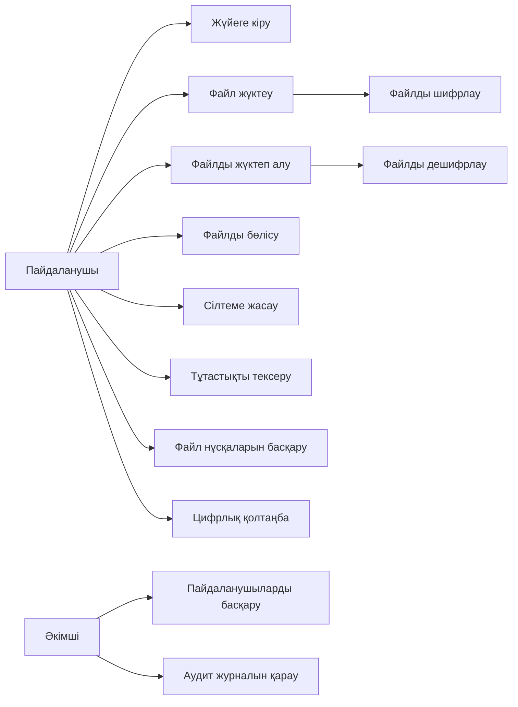
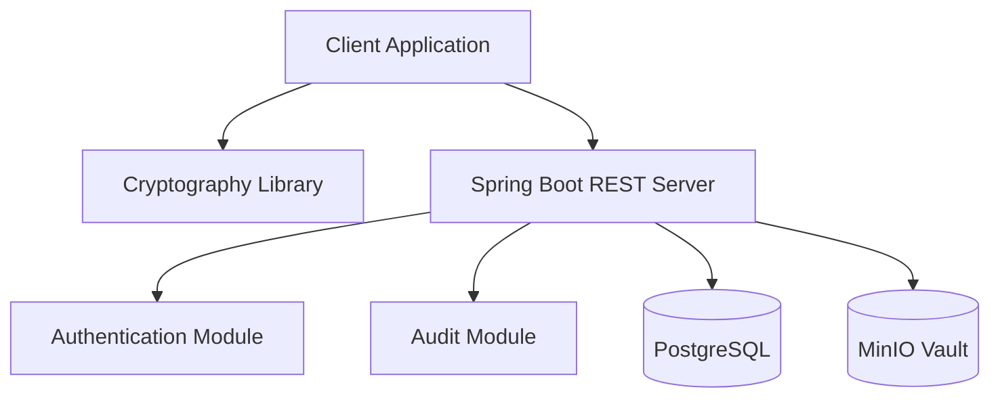
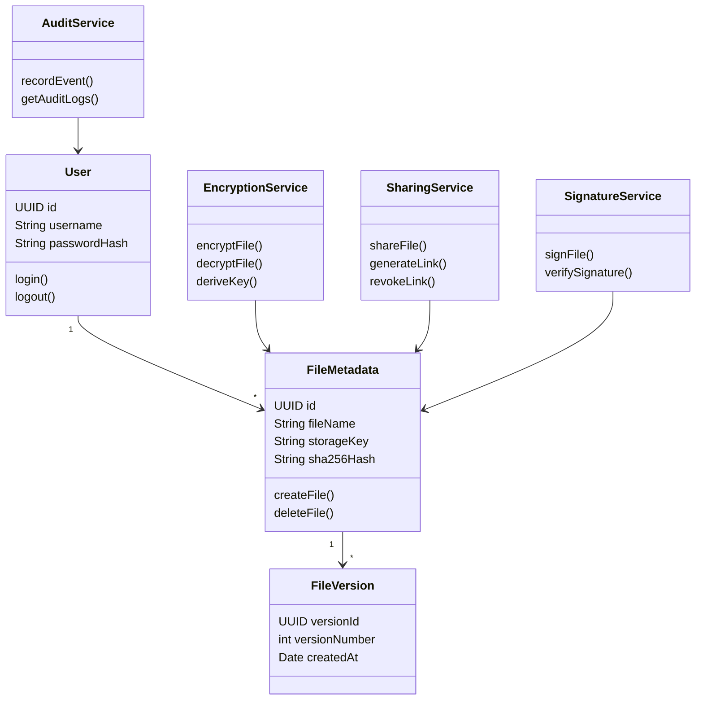
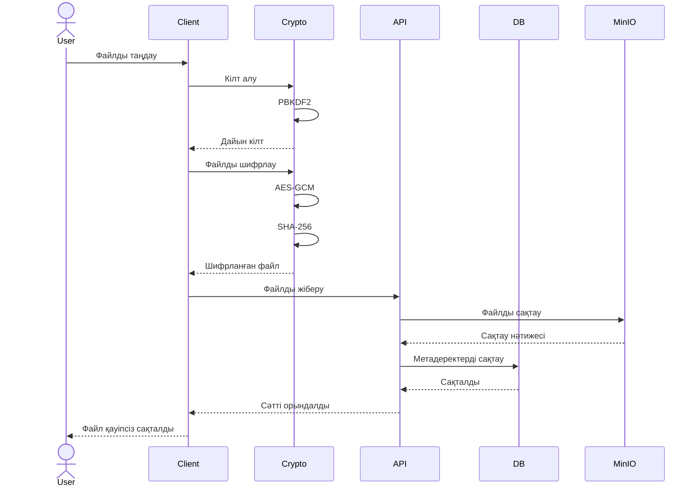

# 🔐 Secure File Storage & Sharing System

## 📌 Жоба туралы

**Secure File Storage & Sharing System** — пайдаланушылардың файлдарын қауіпсіз сақтауға, шифрлауға және басқа пайдаланушылармен қауіпсіз бөлісуге арналған жүйе.

Жүйеде файл серверге жіберілмес бұрын Client Application жағында шифрланады. Шифрланған файл MinIO Vault қоймасында сақталады. Файлдың құпиялылығы мен тұтастығын қамтамасыз ету үшін заманауи криптографиялық алгоритмдер қолданылады.

## 🎯 Жобаның мақсаты

Пайдаланушылардың жеке файлдарын рұқсатсыз қол жеткізуден қорғау, файлдарды қауіпсіз сақтау және оларды шифрланған түрде басқа пайдаланушыларға жіберу мүмкіндігін жасау.

## ⚙️ Негізгі мүмкіндіктер

- **AES-GCM** — файлдарды қауіпсіз шифрлау және дешифрлау.
- **PBKDF2** — пайдаланушы құпиясөзінен криптографиялық кілт жасау.
- **SHA-256** — файлдың тұтастығын тексеру.
- **RSA** — файлдарды басқа пайдаланушылармен қауіпсіз бөлісу.
- **Expiring Links** — белгілі бір уақыттан кейін жарамсыз болатын сілтемелер жасау.
- **File Versioning** — файлдардың бірнеше нұсқасын сақтау және басқару.
- **Digital Signature** — файлдың цифрлық қолтаңбасын жасау және тексеру.
- **Audit Logs** — жүйедегі әрекеттер тарихын тіркеу.
- **Access Control** — пайдаланушылардың құқықтарын басқару.

## 🛠️ Қолданылатын технологиялар

| Технология | Қолданылуы |
|---|---|
| Java 17+ | Негізгі бағдарламалау тілі |
| Spring Boot | REST API Server |
| Java Cryptography Architecture (JCA) | Криптографиялық операциялар |
| AES-GCM | Файлдарды шифрлау |
| PBKDF2 | Кілтті құпиясөзден шығару |
| SHA-256 | Файл тұтастығын тексеру |
| RSA | Кілттерді қауіпсіз бөлісу |
| PostgreSQL | Мәліметтер базасы |
| MinIO | Шифрланған файлдарды сақтау |
| Maven | Project Build Management |
| JUnit 5 | Automated Testing |
| GitHub Actions | CI/CD |

## 🏗️ Жүйенің архитектурасы

Жүйе бірнеше негізгі бөліктен тұрады:

1. **Client Application** — пайдаланушы интерфейсі және файлдармен жұмыс істеу.
2. **Cryptography Library** — файлдарды шифрлау, дешифрлау және тексеру.
3. **REST API Server** — клиент пен сервер арасындағы байланысты қамтамасыз ету.
4. **PostgreSQL** — пайдаланушылар мен файлдардың метадеректерін сақтау.
5. **MinIO Vault** — шифрланған файлдарды сақтау.
6. **Audit Module** — жүйедегі әрекеттерді тіркеу.

### Architecture Diagram



## 👥 Use Case Diagram

Жүйенің негізгі пайдаланушылары мен олардың мүмкіндіктері:



## 🧩 Component Diagram



## 📦 Class Diagram



## 🔄 Sequence Diagram

Файлды қауіпсіз сақтау процесі:



## 🔒 Қауіпсіздік

Жобада келесі қауіпсіздік механизмдері қарастырылады:

- Файлдарды серверге жібермес бұрын Client-side Encryption арқылы шифрлау.
- AES-GCM алгоритмі арқылы файлдардың құпиялылығы мен тұтастығын қорғау.
- PBKDF2 көмегімен құпиясөзден криптографиялық кілт жасау.
- SHA-256 арқылы файлдың өзгертілгенін анықтау.
- RSA арқылы қауіпсіз кілт алмасуды ұйымдастыру.
- Пайдаланушылардың рұқсаттарын тексеру.
- Құпиясөздер мен кілттерді GitHub Repository ішінде сақтамау.

## 📁 Жобаның құрылымы

```text
secure-file-storage/
│
├── client/
│   └── src/
│
├── server/
│   └── src/
│
├── crypto-library/
│   └── src/
│
├── database/
│
├── docs/
│   └── diagrams/
│
├── tests/
│
├── .github/
│   └── workflows/
│
├── README.md
├── LICENSE
└── .gitignore
```

*Ескерту: Бұл — жоспарланған жоба құрылымы. Нақты папкалар мен файлдар әзірлеу барысында қосылады.*

## 🧪 Testing

Жобада JUnit 5 арқылы автоматтандырылған тестілеу жүргізіледі.

Тексерілетін негізгі функциялар:

- AES-GCM Encryption / Decryption.
- PBKDF2 Key Derivation.
- SHA-256 Integrity Verification.
- RSA Encryption / Decryption.
- Digital Signature Verification.
- File Versioning.
- Access Control.
- Expiring Links.

**Мақсат: кемінде 20 JUnit Test жазу.**

## 🔀 Git Workflow

Команда GitHub арқылы бірлесіп жұмыс істейді.

Қолданылатын Branch құрылымы:

- `main` — тұрақты нұсқа.
- `develop` — негізгі әзірлеу нұсқасы.
- `feature/*` — жеке функцияларды әзірлеу.

Жұмыс тәртібі:

1. Әр қатысушы өз Feature Branch ашады.
2. Өзгерістерін Commit арқылы сақтайды.
3. Pull Request ашады.
4. Команда мүшесі Code Review жасайды.
5. Тексерілген код `develop` Branch-ке біріктіріледі.
6. Дайын нұсқа `main` Branch-ке енгізіледі.

## 📅 Project Development Plan

Жоба үш Sprint бойынша орындалады.

### Sprint 1 — Planning & Architecture

- Жобаның талаптарын талдау.
- GitHub Repository құру.
- Trello Board дайындау.
- UML диаграммаларын әзірлеу.
- Жүйе архитектурасын анықтау.
- Project Structure дайындау.

### Sprint 2 — Core Development

- AES-GCM Encryption / Decryption.
- PBKDF2 Key Derivation.
- SHA-256 Integrity Verification.
- Spring Boot REST API.
- PostgreSQL және MinIO интеграциясы.
- Файлдарды жүктеу және жүктеп алу.

### Sprint 3 — Security & Testing

- RSA File Sharing.
- Expiring Links.
- File Versioning.
- Digital Signature.
- Audit Logs.
- JUnit Tests.
- GitHub Actions CI/CD.
- Final Documentation және Project Defense.

## 👨‍💻 Team Members

| Аты-жөні | Рөлі |
|---|---|
| Әуелбек Бақытжан | Team Lead |
| Team Member 2 | Developer |
| Team Member 3 | Developer |
| Team Member 4 | Developer |
| Team Member 5 | Developer |

*Команда мүшелерінің аты-жөні мен нақты міндеттері кейін толықтырылады.*

## 📊 Project Status

**Current Stage:** Planning & Architecture

Жоба әзірлеу кезеңінде. Функциялар Sprint жоспарына сәйкес кезең-кезеңімен жүзеге асырылады.

## 📜 License

Бұл жоба MIT License негізінде таратылады.
